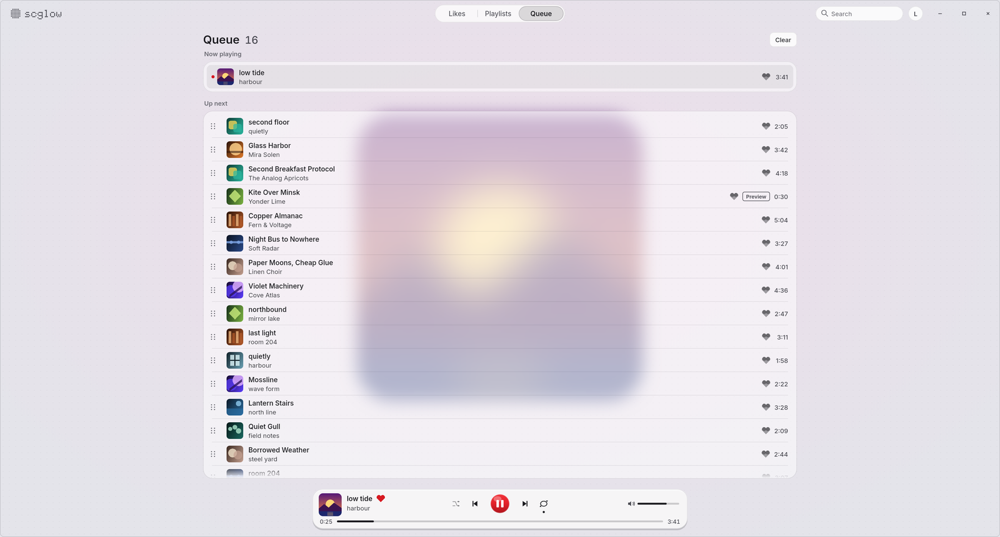

# scglow

A personal desktop SoundCloud client for Windows, built with Flutter.

> **Unofficial.** scglow is not affiliated with, endorsed by, or connected to SoundCloud. It uses SoundCloud's public web endpoints the way the website does, and they may change at any time.


| | |
|---|---|
|  |  |
|  | |

## Features

- Sign in with your SoundCloud account; your likes and playlists load from a local cache, then refresh quietly in the background.
- Fast search and sorting across likes; like and unlike tracks.
- Play queue with drag-to-reorder, shuffle and repeat; resumes where you left off.
- Track side panel with the queue, related tracks and timed comments.
- Focus mode: click the cover in the player, or double-click a track in any list, to show just the sharp cover over soft drifting colors from the cover that brighten on the beat. The player and cursor hide after 3 s without mouse movement; Esc or another click on the cover thumbnail in the player leave it (with the track panel open, the first Esc closes the panel). Space plays/pauses and ←/→ seek 5 s.
- Track panel: click an empty spot of the player or the track title to open or close it (in Focus the panel opens beside the cover, which glides to the middle of the free area).
- Glass UI in dark and light themes. The current cover is shown as a soft blurred backdrop that can pulse to the beat (based on the track's waveform).
- Windows integration: media keys and the system media overlay, a tray icon, and a single running instance.

## Install

Get `scglow-setup-<version>.exe` from [Releases](https://github.com/ravenpupsik/scglow/releases) and run it (Windows 10/11, x64). It installs for your user only, without admin rights, into `%LOCALAPPDATA%\Programs\scglow`, adds a Start menu shortcut (a desktop shortcut is optional) and an entry in Windows Settings > Apps for uninstalling. If the Microsoft Edge WebView2 Runtime (needed for sign-in) is missing, setup downloads and installs it.

Updates: account menu > Check for updates downloads the new setup, checks its SHA-256 and installs it silently, then restarts scglow.

Your sign-in, settings and cache live in `%APPDATA%\scglow`, not in the program folder, so they survive updates and reinstalls. Uninstalling asks whether to delete them (default: keep).

A portable `scglow-windows-<version>.zip` is still attached for older versions of the app. A portable copy of 1.6.5 or newer moves itself to the installer once: on start it downloads the setup of the latest release, installs it and starts the installed copy. Setup also points existing scglow shortcuts at the installed copy. The old folder can be deleted afterwards.

## Publishing a release

Requirements: everything under [Build](#build), plus [Inno Setup 6.3+](https://jrsoftware.org/isdl.php).

```powershell
powershell -ExecutionPolicy Bypass -File .\tool\build_release.ps1
```

This runs `flutter build windows --release`, compiles `installer\installer.iss` with the version from `pubspec.yaml` (keep `lib/core/app_version.dart` in sync), and writes to `dist\`: `scglow-setup-<version>.exe`, `scglow-windows-<version>.zip` and a `.sha256` file for each. Create a GitHub Release tagged `v<version>` and attach all four. The in-app updater reads the latest release, prefers the setup over the zip, prefers the asset's SHA-256 `digest` when GitHub provides one, and otherwise uses the `.sha256` file. A release without a checksum is refused.

The installer's `AppId` (in `installer\installer.iss`) must never change, or new versions install next to the old one. Do not change `CompanyName` or `ProductName` in `windows\runner\Runner.rc` either: they decide the `%APPDATA%` data folder.

The MSVC runtime (`msvcp140.dll`, `vcruntime140.dll`, `vcruntime140_1.dll`) is copied next to `scglow.exe` by the CMake install step, so no VC++ Redistributable is needed.

## Build

Requirements: Windows 10/11, the [Flutter SDK](https://docs.flutter.dev/get-started/install/windows/desktop) (stable) with Visual Studio's "Desktop development with C++" workload.

```powershell
flutter pub get
flutter build windows
```

The app is written to `build\windows\x64\runner\Release\scglow.exe`.

If `flutter pub get` fails with "requires symlink support", either turn on Windows Developer Mode (`start ms-settings:developers`) or link the plugins with junctions after every `pub get`:

```powershell
powershell -ExecutionPolicy Bypass -File .\scripts\link_plugins.ps1
```

The WebView plugin needs `nuget.exe` on the `PATH` during the build.

## Tests

```powershell
flutter test                                  # offline unit and widget tests
flutter test --run-skipped --tags live        # network checks against public SoundCloud pages
```

The preview tests render screenshots to `build/previews` (set `PREVIEW_OUT` to change it).

## How it talks to SoundCloud

- The public web `client_id` is read at runtime from soundcloud.com's script bundles and cached locally; nothing is hard-coded.
- Your sign-in token is kept in encrypted local storage (flutter_secure_storage) and is only sent to SoundCloud.
- A small diagnostic log (`%TEMP%\scglow.log`) records request paths and status codes only, never tokens, query strings or headers.

## License

[MIT](LICENSE) © 2026 tennesyst
