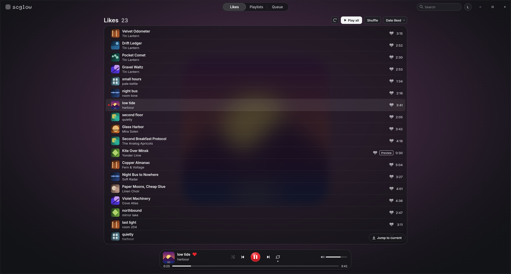
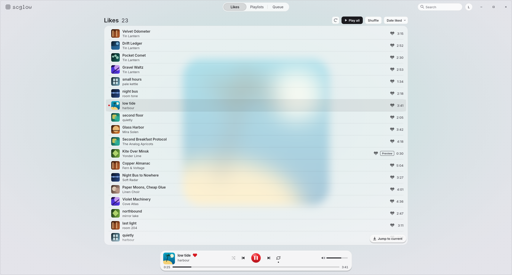
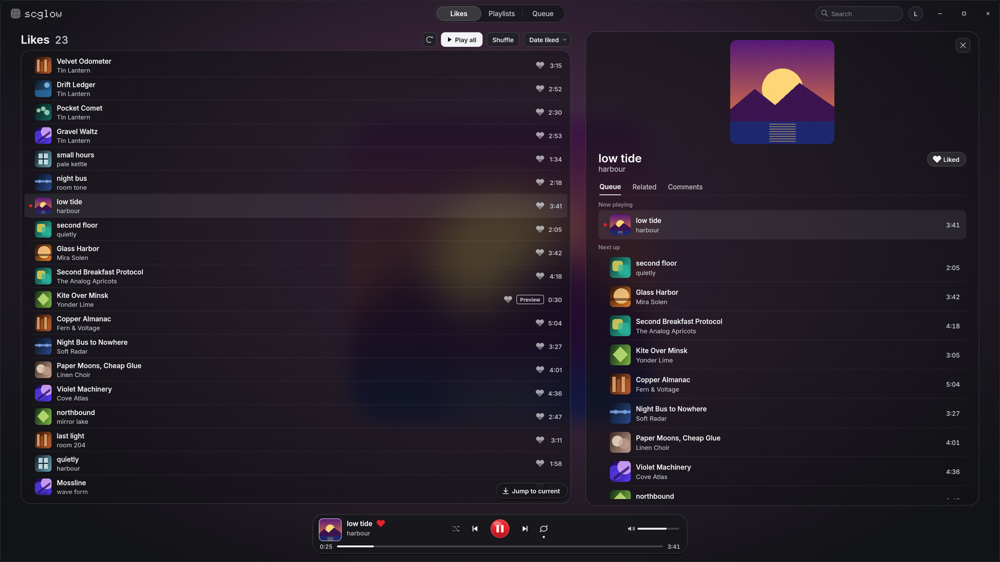

# scglow

A personal desktop SoundCloud client for Windows, built with Flutter.

> **Unofficial.** scglow is not affiliated with, endorsed by, or connected to SoundCloud. It uses SoundCloud's public web endpoints the way the website does, and they may change at any time.



| | |
|---|---|
|  |  |
|  | |

## Features

- Sign in with your SoundCloud account; your likes and playlists load from a local cache, then refresh quietly in the background.
- Fast search and sorting across likes; like and unlike tracks.
- Play queue with drag-to-reorder, shuffle and repeat; resumes where you left off.
- Track side panel with the queue, related tracks and timed comments.
- Glass UI in dark and light themes. The current cover is shown as a soft blurred backdrop that can pulse to the beat (based on the track's waveform).
- Windows integration: media keys and the system media overlay, a tray icon, and a single running instance.

## Download

Get `scglow-windows-<version>.zip` from [Releases](https://github.com/ravenpupsik/scglow/releases), unzip it anywhere and run `scglow.exe` (Windows 10/11, x64). Older releases used the name `scglow-<version>-windows-x64.zip`; both still work.

## Publishing a release

After `flutter build windows --release`:

```powershell
powershell -ExecutionPolicy Bypass -File .\tool\package_release.ps1
```

This writes `release\scglow-windows-<version>.zip` and `release\scglow-windows-<version>.zip.sha256`. Create a GitHub Release tagged `v<version>` (for example `v1.6.4+26`) and attach both files. The in-app updater reads the latest release, prefers the asset's SHA-256 `digest` when GitHub provides one, and otherwise uses the `.sha256` file. A release without a checksum is refused.

## Build

Requirements: Windows 10/11, the [Flutter SDK](https://docs.flutter.dev/get-started/install/windows/desktop) (stable) with Visual Studio's "Desktop development with C++" workload.

```powershell
flutter pub get
flutter build windows
```

The app is written to `build\windows\x64\runner\Release\scglow.exe`.

If `flutter pub get` fails with "requires symlink support", either turn on Windows Developer Mode (`start ms-settings:developers`) or link the plugins with junctions after every `pub get`:

```powershell
powershell -ExecutionPolicy Bypass -File .\scripts\link_plugins.ps1
```

The WebView plugin needs `nuget.exe` on the `PATH` during the build.

## Tests

```powershell
flutter test                                  # offline unit and widget tests
flutter test --run-skipped --tags live        # network checks against public SoundCloud pages
```

The preview tests render screenshots to `build/previews` (set `PREVIEW_OUT` to change it).

## How it talks to SoundCloud

- The public web `client_id` is read at runtime from soundcloud.com's script bundles and cached locally; nothing is hard-coded.
- Your sign-in token is kept in encrypted local storage (flutter_secure_storage) and is only sent to SoundCloud.
- A small diagnostic log (`%TEMP%\scglow.log`) records request paths and status codes only, never tokens, query strings or headers.

## License

[MIT](LICENSE) © 2026 tennesyst
